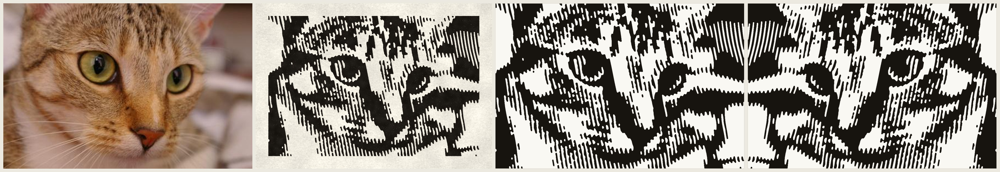
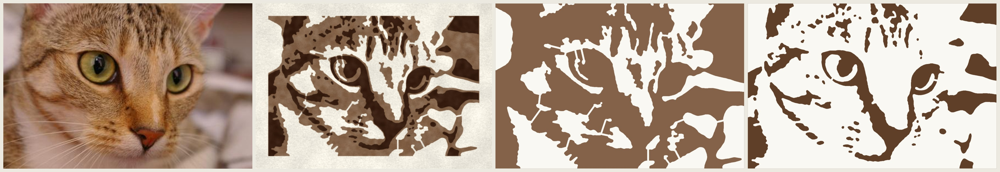
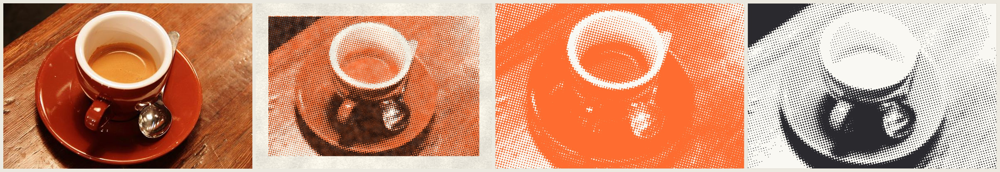
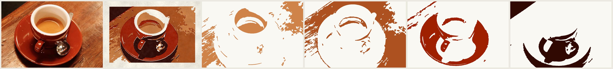
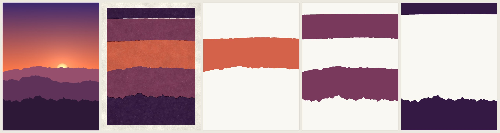

# printlayers

A Claude skill that turns your own photo or drawing into flat ink layers for linocut, screen print, stencils (spray or Cricut) and risograph.







Each strip: original, proof (the layers overprinted on paper with slight misregistration), then the layers. The linocut strip ends with the mirrored layer, ready to carve.

You get, per image: one SVG per layer (black = ink, real size in mm), one PNG per layer, a mirrored SVG for linocut, a proof, and a contact sheet. Stencil layers get thin bridges so islands (the middle of an O) don't fall out. Multi-layer SVGs carry registration marks.

## Use it with Claude

**claude.ai / Claude app:** download [`printlayers-skill.zip`](printlayers-skill.zip) and upload it in your skills settings. Then send Claude a photo or a drawing and say what you want to make: a linocut, a 3-colour screen print, a Cricut stencil.

**Claude Code:**

```bash
git clone https://github.com/thibaud360/printlayers
cp -r printlayers/skills/printlayers ~/.claude/skills/
```

## Just want a prompt?

Send this to Claude with your image attached (it needs code execution):

```text
Prepare this image for a linocut. With Python (OpenCV, NumPy): grayscale, CLAHE, slight blur, then threshold with Otsu so shadows become solid black and everything else white. Remove specks and fill gaps thinner than 0.6 mm at 150 mm print width, vectorise with cv2.findContours + approxPolyDP and save an SVG (black fill, fill-rule evenodd, width in mm). Also save the horizontally mirrored SVG for carving, and a PNG preview.
```

For the full version (carved-line midtones, multi-colour layers, stencil bridges, riso halftone, proof) use the skill.

## Use it without Claude

```bash
pip install pillow numpy opencv-python scipy scikit-learn scikit-image
python skills/printlayers/scripts/printlayers.py photo.jpg --mode linocut
python skills/printlayers/scripts/printlayers.py photo.jpg --mode screenprint --layers 3
python skills/printlayers/scripts/printlayers.py photo.jpg --mode screenprint --inks "#1B2A49" "#E4572E" "#F2C14E"
python skills/printlayers/scripts/printlayers.py logo.png --mode stencil --layers 1 --width-mm 200
python skills/printlayers/scripts/printlayers.py photo.jpg --mode riso
```

Flags: `--mode linocut|screenprint|stencil|riso`, `--layers`, `--inks`, `--detail 1-5`, `--width-mm`, `--paper`, `--texture lines|none`, `--line-mm`, `--angle`, `--bridge-mm`, `--cell-mm`, `--mirror auto|on|off`, `--misreg`, `--no-marks`, `--px`, `--strip`, `-o`.

## License

MIT
